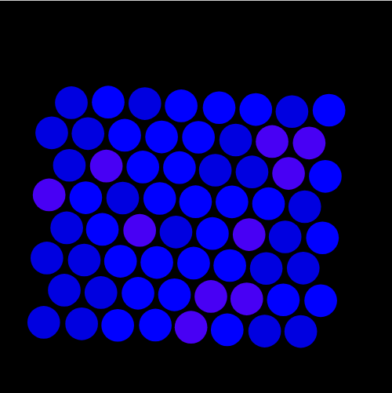
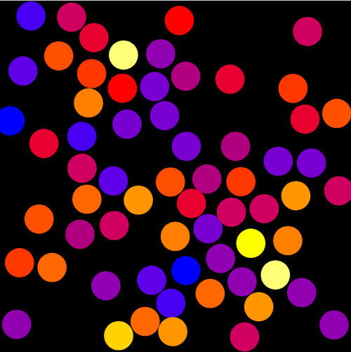
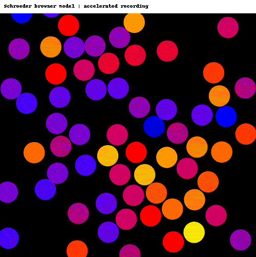

# הדגמת המנחה: תנועה של חלקיקים

נשתמש ב[סימולטור המולקולרי של דניאל שרודר](https://physics.weber.edu/schroeder/md/). בהדגמה יש 64 חלקיקים בריבוע שאורך צלעו 12, ללא כבידה, קשרים נוספים, חלקיקים מעוגנים או חלקיקים בטמפרטורה קבועה. האורכים והזמנים נמדדים ביחידות המודל; הטמפרטורה אינה בהכרח בקלווין.

זהו מודל עם כוחות בין חלקיקים, בשונה משלושת תרגילי התכנות. ההדגמה תיעשה יחד בכיתה. ההוראות המפורטות להמשך מאפשרות לחזור אליה באופן עצמאי אם תרצו להעמיק.

## מתחילים מאותו מצב

1. הורידו את [קובץ המצב ההתחלתי](../../meetings/01_introduction/presets/ordered_initial.txt).
2. עצרו את הסימולטור, פתחו **Data**, בחרו **All atoms**, הדביקו את תוכן הקובץ במלואו ולחצו **Input state**. שמרו את הקובץ שטענתם.
3. בדקו שמספר החלקיקים הוא 64, אורך הצלע 12, הכבידה 0 וצעד הזמן 0.005. הקובץ מגדיר מיקומים ומהירויות התחלתיים בסידור משולש, שנוצר באמצעות זרע אקראי קבוע.
4. הגדירו **Steps per frame** לערך 200 ולחצו **Step** חמש פעמים. כך מתקדמים 1,000 צעדים, שהם 5 יחידות זמן. חוזרים על ההכנה הזאת לפני כל השוואה.

## ההדגמה בכיתה

לפני השינוי ננסה לצפות כיצד תוספת אנרגיה תשפיע על התנועה. מהמצב שהכנו, הכפתור **Faster** מגדיל את המהירויות. במצב האנרגיה הגבוהה שתועד בהדגמה לחצנו עליו 24 פעמים כשהסימולטור עצור. נשאיר את מספר החלקיקים ואת הקופסה קבועים, נלחץ **Step** חמש פעמים ונתבונן בתנועה ובסידור.

אם הסימולטור אינו זמין, אפשר להשתמש בתיעוד המופיע בהמשך. תמונה של סידור לא מסודר אינה מספיקה כדי לקבוע שהמערכת היא נוזל בשיווי משקל.

## למי שרוצה להמשיך: שלוש הכנות להשוואה

טענו מחדש את אותו מצב התחלתי ובצעו בכל פעם את 1,000 צעדי ההכנה. נסו 0, 8 ו־24 לחיצות על **Faster** ליצירת הכנות באנרגיה נמוכה, בינונית וגבוהה. מכפילי המהירות הם בהתאמה 1, כ־2.144 וכ־9.850; אלה אינם ערכי טמפרטורה. לאחר השינוי התקדמו עוד 1,000 צעדים כפרק המתנה מתועד. זהו נוהל לימודי, ואין בו הוכחה שהמערכת הגיעה לשיווי משקל.

## תיעוד חלון מדידה

לאחר ההמתנה לחצו **Reset stats**. הכפתור מאפס את הזמן והסטטיסטיקה המוצגים, ולא את מצב החלקיקים. פתחו **Data**, בחרו **System totals** ו־**More detail**, כבו את **Auto interval** ונקו נתונים קודמים. הגדירו **Steps per frame** לערך 25. חזרו 40 פעמים על **Step** ואחריו **Write data**. כך נרשם חלון של 5 יחידות זמן במרווחים של 0.125. העתיקו את הנתונים המופרדים בטאבים לקובץ טקסט ושמרו אותו מחוץ לסימולטור.

הייצוא המפורט כולל את מספר החלקיקים N, האנרגיה הקינטית KE והאנרגיה הפוטנציאלית PE. במודל הדו־ממדי הזה, ללא חלקיקים מעוגנים, ממוצע KE/N על השורות שנרשמו נותן את הטמפרטורה ביחידות המודל. ממוצע PE/N נותן אנרגיה פוטנציאלית לחלקיק. עמודת T המוצגת עשויה להיות ממוצע מצטבר, ולכן אין להתייחס לכל ערך בה כאל דגימה רגעית עצמאית.

מחברת תרגיל 2 מהמסלול המקורי שבארכיון כוללת כלי עזר לייצוא הזה; מחברת ההרחבה 02 היא אפשרות נוספת לניתוח בהמשך. שמרו גם צילומי מסך ותעדו הגדרות, הכנה וחלון מדידה.

אפשר לחזור על התנאי האמצעי מאותו מצב שמור. שחזור זהה בודק את הנוהל; הוא אינו אומדן אי־ודאות מזרעים עצמאיים. מחקר רחב יותר דורש הכנות עצמאיות ובדיקות של הדגימה. שמרו גם תוצאות שלא ציפיתם להן.

## מקור וגיבוי להדגמה

באתר הסימולטור מוסברים חוקי המודל והפקדים. חומרי הקורס כוללים הקלטה, תמונות, מצבי התחלה ונתוני דוגמה מדודים מהרצת הכנה אוטומטית בדפדפן. כשמשתמשים בהם, מציינים במחברת שמדובר בנתוני הדוגמה ומציינים את המקור.

## ההדגמה המתועדת

אלה תצפיות קצרות מהמודל בדפדפן; הן אינן סיווגים של מצבי צבירה.

<figure><figcaption>תצפית באנרגיה נמוכה. מקור: סימולטור שרודר, הרצת הכנה לקורס.</figcaption></figure>
<figure><figcaption>תצפית באנרגיה גבוהה באותו מודל ובאותה קופסה. לא נקבע כאן מצב צבירה בשיווי משקל.</figcaption></figure>
<figure><figcaption>הקלטה מואצת של המודל החיצוני.</figcaption></figure>

[הורדת ממוצעי המדידות לדוגמה](../../data/examples/window_averages.csv) · [פרטי מקור הנתונים](../../data/examples/metadata.json)
