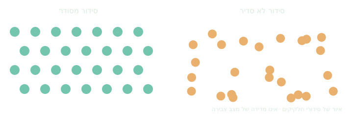

# מאטומים לתוצאות
צעדים ראשונים במחקר באמצעות סימולציה.

כללים פשוטים יכולים ליצור תנועה מפתיעה. נלמד לשנות אותם בקוד, להתבונן בתוצאה ולבחור מדידה שתעזור להבין מה קרה. לאורך הדרך נכיר כלים שמשמשים גם במחקר: ניסוי מבוקר, גרפים ובדיקת קוד.

## המפגש הראשון

| דקות | מה נעשה יחד |
|---|---|
| <bdi dir="ltr">0–8</bdi> | היכרות ושיחה על משהו שסיקרן אתכם בקריאה |
| <bdi dir="ltr">8–18</bdi> | היכרות עם המחקר: אטומים, תנועה ומדידות |
| <bdi dir="ltr">18–30</bdi> | הדגמה אחת בהנחיית המנחה: נצפה שינוי ונראה מה קורה |
| <bdi dir="ltr">30–50</bdi> | פתיחה, עריכה, הרצה ושמירה של מחברת ב־Colab |
| <bdi dir="ltr">50–60</bdi> | היכרות עם התרגילים להמשך ותרגול שיתוף העבודה |

[מצגת ההיכרות](https://yaminbens.github.io/alpha-mentorship/presentation/slides.html) · [הורדת המצגת כ־PDF](../../meetings/01_introduction/slides.pdf) · [הדגמת המנחה](browser.md)

## המסלול שלכם

1. [פתיחה: המחברת הראשונה](task-0.md) — מתחילים יחד בכיתה. משנים משתנה, מוסיפים שורת קוד ושומרים עותק אישי.
2. [תרגיל 1: פותחים מעבר](task-1.md) — משנים פתח במחיצה, צופים בערבוב ומשלימים קוד לספירה ולגרף. כ־<bdi dir="ltr">35–45</bdi> דקות.
3. [תרגיל 2: משנים את חוק הקפיצה](task-2.md) — יוצרים קפיצות מתמשכות או דעיכה ומשווים ריצות באמצעות לולאה. כ־<bdi dir="ltr">40–50</bdi> דקות.
4. [תרגיל 3: כותבים סימולציה](task-3.md) — משלימים פונקציות ולולאת זמן ויוצרים מסלול של חלקיק בקופסה. כ־<bdi dir="ltr">50–70</bdi> דקות.
5. [קריאה מלווה](readings.md) — הסברים קצרים וקטעים נבחרים שעוזרים להבין את הרעיונות שבהם משתמשים.
6. [שמירה ושיתוף](submit.md) — שומרים את העבודה ובוחרים משהו שתרצו להראות למנחה.

התרגילים המלאים מיועדים לעבודה עצמאית; אפשר לחלק כל תרגיל לכמה מפגשים. הזמנים הם הערכה לצורך תכנון. הביאו למפגש מחשב נייד ומטען ובדקו שיש לכם גישה ל־Colab דרך חשבון Google. אין צורך להתקין תוכנה. בהמשך ניעזר בהיכרות שלכם עם משתנים, תנאים ולולאות ונכיר בהדרגה כלים נוספים.

## מתחילים עם תבנית

בכל דף תרגיל תמצאו כפתור **פתיחה ב־Colab** ומחברת עם הסברים, קוד וקטעים להשלמה. שמרו עותק אישי ב־Drive לפני העריכה. אפשר להתקדם באמצעות המחברות הנפרדות, או להשתמש במחברת המאוחדת הבאה שמכילה את כל השלבים:

[פתיחה ב־Colab](https://colab.research.google.com/github/yaminbens/alpha-mentorship/blob/main/notebooks/student_workbook_he.ipynb)
[הורדת המחברת](../../notebooks/student_workbook_he.ipynb)

לקראת השיחה עם המנחה, בחרו משהו שסיקרן אתכם, עבד בקלות, היה מאתגר או עורר רצון להמשיך. גם ניסיון חלקי או תוצאה לא צפויה יכולים להיות התחלה טובה לשיחה. אפשר להיעזר ב[דף ההתרשמות](../../assignments/reflection_he.md).

התרגילים משתמשים בחלקיקים ללא כוחות ביניהם. הדגמת המנחה עוסקת במודל מולקולרי עם כוחות; נשמור על ההבחנה בין המודלים כשנפרש תוצאות.
